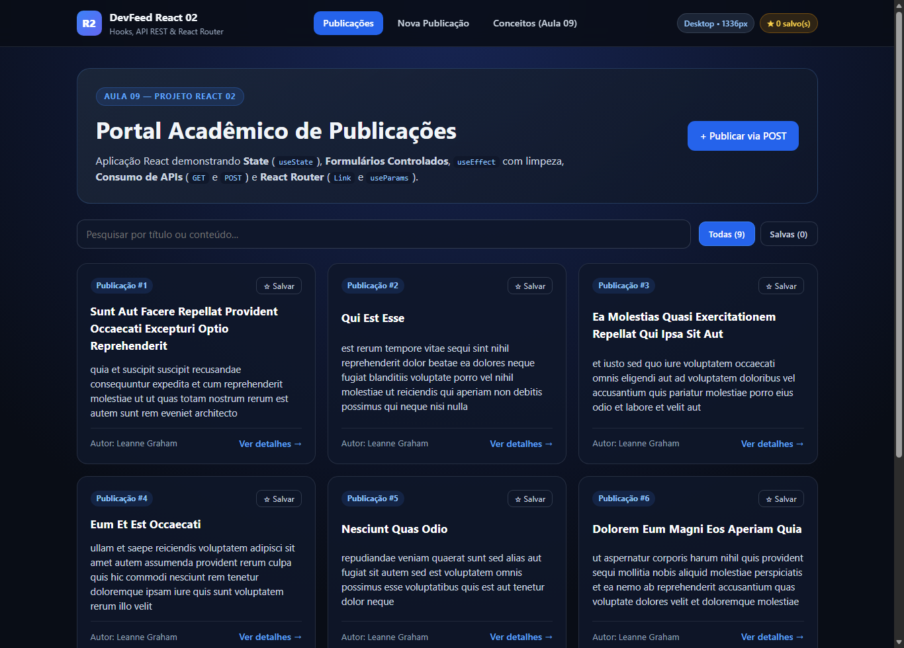

# 🚀 DevFeed React 02 — Hooks, Consumo de API e React Router

Aplicação Front-end responsiva desenvolvida com **React 19, Vite e React Router 7** para atender integralmente à **Atividade Prática da Aula 09 (Projeto React 02)** da disciplina de **Frameworks Front-end** (SENAI).

- **Deploy em Produção (Vercel):** [🌐 Ver online](https://projeto-react-02-zeta.vercel.app)
- **Repositório GitHub:** [🔗 Repositório](https://github.com/Enzootomas/projeto-react-02)

---

## 📸 Captura de Tela da Aplicação em Funcionamento



---

## 🎯 Descrição da Atividade

Desenvolver uma aplicação React completa aplicando todos os conceitos estudados na **Aula 09**: **State e `useState`**, **Formulários Controlados** com validação e `preventDefault()`, **`useEffect` com função de limpeza (*cleanup*)**, **Consumo de APIs (`fetch` `GET` e `POST`)** com tratamento de erros e **React Router** com navegação declarativa e parâmetros dinâmicos (`useParams`).

---

## 📚 Conceitos Aplicados (Aula 09)

| # | Conceito | Implementação no Código |
|---|---|---|
| 01 | **State e `useState`** | Gerenciamento reativo de publicações, favoritos, busca textual, abas de filtro, estados de carregamento/envio e contador demonstrativo em `PaginaConceitos` |
| 02 | **Formulários Controlados** | `PaginaNovaPublicacao` com inputs controlados (`value` + `onChange`), evento `onSubmit`, `evento.preventDefault()` e validação de campos obrigatórios |
| 03 | **`useEffect` e Limpeza (`cleanup`)** | 1) Atualização dinâmica de `document.title` conforme a rota;<br>2) Listener `window.addEventListener("resize", ...)` em `Navbar.jsx` com remoção no `return () => removeEventListener(...)`;<br>3) Cancelamento de requisições HTTP com `AbortController` |
| 04 | **Consumo de APIs (`GET` e `POST`)** | Consulta `GET` de posts, autores e comentários na API `JSONPlaceholder` verificando `response.ok` + envio `POST` com `headers` e `JSON.stringify()` |
| 05 | **React Router (`react-router-dom`)** | `BrowserRouter`, `Routes`, `Route`, `NavLink`, `Link`, `useNavigate`, `useLocation` e rota dinâmica `/publicacoes/:id` lendo parâmetros com `useParams()` |

---

## ✨ Funcionalidades Implementadas

- Feed de publicações carregado assincronamente de API externa (`GET /posts` e `GET /users`);
- Busca instantânea por palavra-chave e filtro dedicado de publicações salvas nos favoritos (`localStorage`);
- Página de detalhes individuais (`/publicacoes/:id`) utilizando `useParams()` e carregando comentários relacionados (`GET /posts/:id/comments`);
- Formulário controlado para criação de nova publicação via requisição `POST /posts` com retorno do payload JSON;
- Monitor de resolução da janela em tempo real no topo (`Mobile / Tablet / Desktop`), demonstrando limpeza de eventos no `useEffect`;
- Página didática interativa mapeando cada conceito da Aula 09.

---

## 🛠️ Tecnologias Utilizadas

- React 19
- Vite 6
- React Router DOM 7
- Fetch API / JSONPlaceholder REST API
- CSS3 Responsivo (Flexbox, Grid e Media Queries)

---

## 📁 Estrutura de Diretórios

```text
projeto-react-02/
├── docs/
│   └── screenshot-react-02.png
├── src/
│   ├── components/
│   │   ├── Navbar.jsx          # Navegação SPA + monitor de resize com cleanup
│   │   └── PostCard.jsx        # Cartão reutilizável com props e Link dinâmico
│   ├── App.jsx                 # Rotas, estado global, fetch GET/POST e useParams
│   ├── main.jsx                # Configuração do BrowserRouter
│   └── styles.css              # Estilização responsiva
├── .gitignore
├── index.html
├── package.json
├── vercel.json                 # Rewrites SPA para publicação na Vercel
├── vite.config.js
└── README.md
```

---

## 🚀 Instruções de Instalação e Execução

```bash
git clone https://github.com/Enzootomas/projeto-react-02.git
cd projeto-react-02
npm install
npm run dev
```

Acesse o endereço exibido pelo Vite (geralmente `http://localhost:5173`).

Para gerar o build de produção:

```bash
npm run build
```

---

## 🔗 Repositórios Relacionados

- **Central de Estudos da Disciplina:** [https://github.com/Enzootomas/frontend-learning-hub](https://github.com/Enzootomas/frontend-learning-hub)

---

## 🎓 Disciplina

**Frameworks Front-end** — Curso Superior de Tecnologia em Análise e Desenvolvimento de Sistemas (SENAI)  
**Professor:** Me. Deivison S. Takatu
